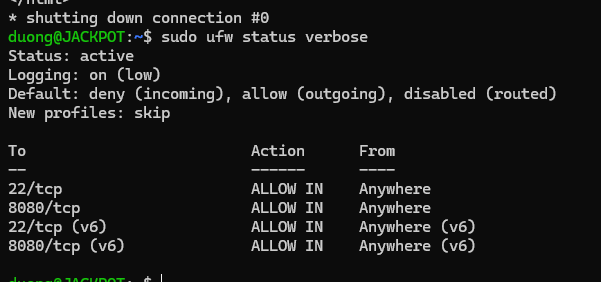
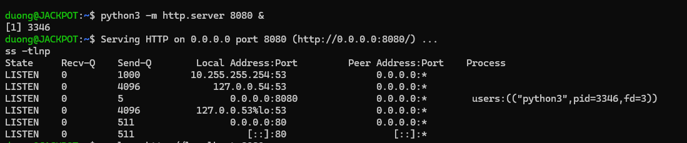
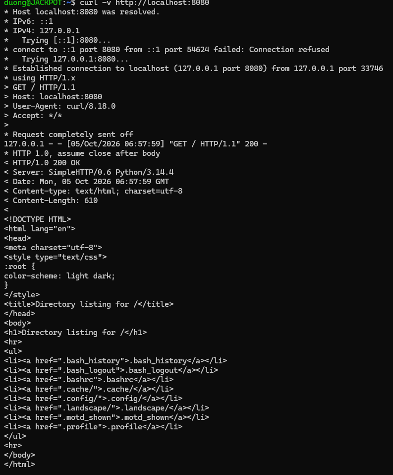

# Bài 3: Cấu hình tường lửa UFW và chuẩn đoán cổng mạng

## 1. Mục tiêu
Bảo vệ máy chủ Cloud VPS bằng UFW, chỉ mở các cổng cần thiết để deploy app web:
- Chính sách mặc định: `deny incoming`, `allow outgoing`
- Mở SSH `22/tcp` để giữ kết nối quản trị
- Mở Web app `8080/tcp`
- Kiểm tra bằng `sudo ufw status verbose`, `ss -tlnp`, `curl`

## 2. Môi trường thực hành
- WSL2 Ubuntu trên Windows (`wsl -l -v` -> `Ubuntu Running 2`)
- User: `duong@JACKPOT:~$`
- Công cụ: `ufw`, `iproute2 (ss)`, `curl`, `python3`

## 3. Các bước thực hiện

### 3.1. Cài đặt UFW (vì WSL mới chưa có sẵn)
```bash
sudo apt update
sudo apt install -y ufw iproute2 curl
sudo ufw --version
```
Lỗi gặp ban đầu: `sudo: 'ufw': command not found` -> đã fix bằng `apt install ufw`.

### 3.2. Cấu hình chính sách mặc định
```bash
sudo ufw default deny incoming
sudo ufw default allow outgoing
```

### 3.3. Mở cổng SSH và Web (làm TRƯỚC khi enable để không mất SSH)
```bash
sudo ufw allow 22/tcp
sudo ufw allow 8080/tcp
```

### 3.4. Kích hoạt tường lửa
```bash
sudo ufw enable
# nhấn y để xác nhận
sudo ufw status verbose
```

### 3.5. Giả lập app web cổng 8080 để kiểm tra chẩn đoán
```bash
python3 -m http.server 8080 &
ss -tlnp
curl -v http://localhost:8080
```

## 4. Kết quả kiểm tra

### 4.1. `sudo ufw status verbose` — ĐẠT
```text
Status: active
Logging: on (low)
Default: deny (incoming), allow (outgoing), disabled (routed)
New profiles: skip

To                         Action      From
--                         ------      ----
22/tcp                     ALLOW IN    Anywhere
8080/tcp                   ALLOW IN    Anywhere
22/tcp (v6)                ALLOW IN    Anywhere (v6)
8080/tcp (v6)              ALLOW IN    Anywhere (v6)
```
Nhận xét:
- `Status: active` ✅
- `Default: deny (incoming), allow (outgoing)` ✅
- `22/tcp ALLOW IN Anywhere` ✅
- `8080/tcp ALLOW IN Anywhere` ✅

### 4.2. `ss -tlnp` — thấy app LISTEN 8080
```text
State     Recv-Q    Send-Q        Local Address:Port         Peer Address:Port    Process
LISTEN    0         5                   0.0.0.0:8080              0.0.0.0:*        users:(("python3",pid=3346,fd=3))
```
Giải thích: `0.0.0.0:8080 LISTEN` nghĩa là app Python (`pid=3346`) đang lắng nghe mọi IP trên cổng 8080.

Toàn bộ output thực tế trên máy:
```text
State     Recv-Q    Send-Q        Local Address:Port         Peer Address:Port    Process
LISTEN    0         1000         10.255.255.254:53                0.0.0.0:*
LISTEN    0         4096             127.0.0.54:53                0.0.0.0:*
LISTEN    0         5                   0.0.0.0:8080              0.0.0.0:*        users:(("python3",pid=3346,fd=3))
LISTEN    0         4096          127.0.0.53%lo:53                0.0.0.0:*
LISTEN    0         511                 0.0.0.0:80                0.0.0.0:*
LISTEN    0         511                    [::]:80                   [::]:*
```

### 4.3. `curl -v http://localhost:8080` — ĐẠT
```text
*   Trying 127.0.0.1:8080...
* Established connection to localhost (127.0.0.1 port 8080)
> GET / HTTP/1.1
< HTTP/1.0 200 OK
< Server: SimpleHTTP/0.6 Python/3.14.4
<h1>Directory listing for /</h1>
```
Kết nối thành công, HTTP `200 OK`.

## 5. Ảnh minh chứng (screenshot)

Ảnh chụp thật từ terminal WSL Ubuntu trên máy sinh viên:

### `sudo ufw status verbose`


### `ss -tlnp`


### `curl -v http://localhost:8080`


## 6. Kết luận
- Đã cấu hình UFW đúng ràng buộc đề bài.
- Firewall đang `active`, chỉ mở `22/tcp` và `8080/tcp`.
- App demo cổng 8080 hoạt động, chẩn đoán bằng `ss` và `curl` thành công.
